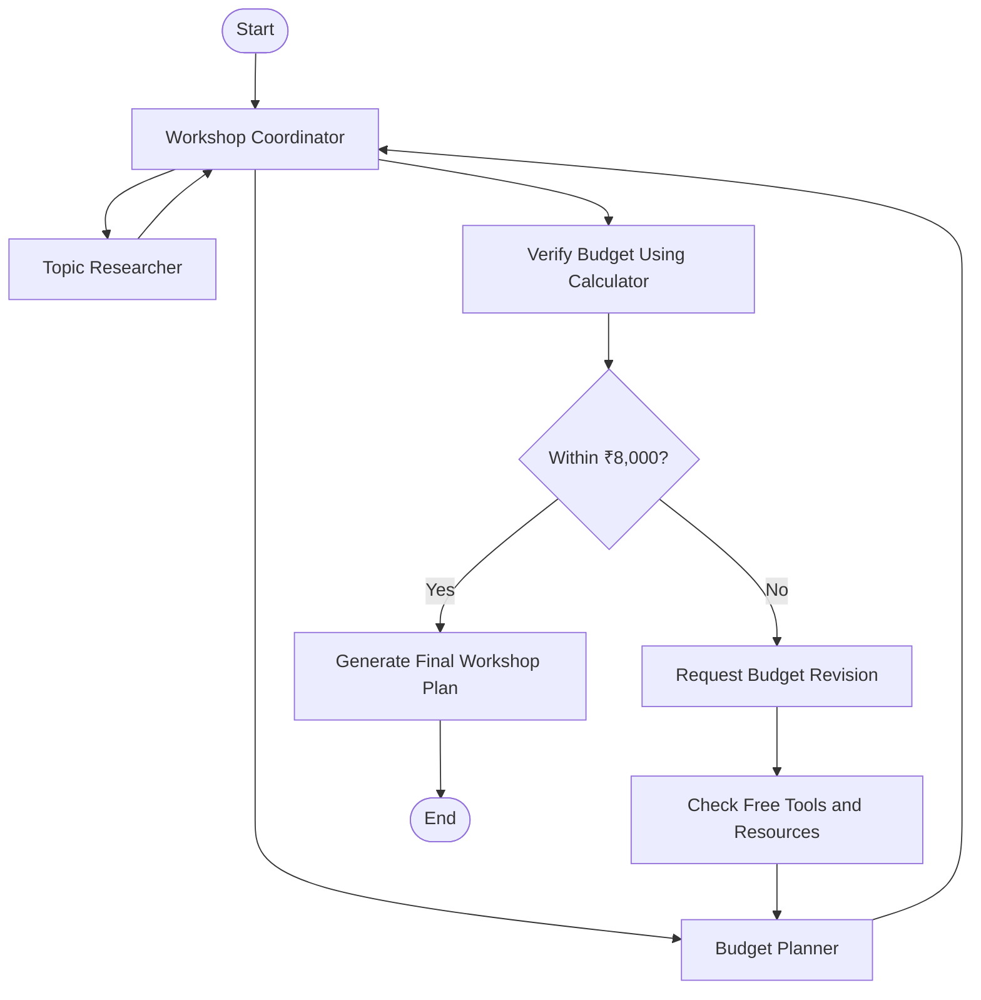

# Multi-Agent Workshop Planner using LangGraph

## 📌 Project Overview

This project demonstrates a **Multi-Agent System** in which three AI agents collaborate to plan a one-day technical workshop for college students within a fixed budget of ₹8,000.

The system is developed using **Python, LangGraph, and Google's Gemini API**. Each agent has a specific responsibility, and they communicate through a shared state managed by a Coordinator agent.

The agents work together to select a suitable workshop topic, estimate expenses, review the budget, and generate a final workshop plan.

## 🎯 Problem Statement

Planning a technical workshop involves multiple activities, such as selecting a relevant topic, identifying required resources, estimating expenses, and ensuring that the plan stays within the available budget.

A single agent may not handle all these responsibilities effectively. Therefore, this project uses three specialized agents that collaborate and verify each other's work.

**Shared Task:** Plan a one-day technical workshop for college students with a maximum budget of ₹8,000.

## 🤖 Multi-Agent Architecture

The project consists of three role-based agents:

| Agent Name | Role | Tools | What It Must Never Do |
|---|---|---|---|
| Topic Researcher | Selects a suitable workshop topic and suggests learning activities. | Topic Checklist | Must not invent confirmed facts or handle budgeting. |
| Budget Planner | Estimates the expenses required for the workshop. | Budget Sheet, Calculator | Must not choose the topic or report costs below the minimum estimates. |
| Workshop Coordinator | Supervises agents, checks calculations, requests revisions, and prepares the final plan. | Calculator, Budget Check, Decision Rules | Must not accept unverified calculations or ignore missing information. |

## 🔄 Agent Collaboration Workflow

The agents communicate through a supervisor-based workflow using LangGraph.

1. The Coordinator receives the workshop planning task.
2. The Topic Researcher selects a suitable topic and suggests activities.
3. The Coordinator forwards the topic to the Budget Planner.
4. The Budget Planner estimates the required expenses.
5. The Coordinator independently verifies the total using Python functions.
6. If the budget exceeds ₹8,000, the Coordinator requests revisions.
7. The Topic Researcher checks whether free tools and college resources can be used.
8. The Budget Planner prepares a revised estimate.
9. Once the budget is verified, the Coordinator generates the final workshop plan.

The system allows a maximum of three budget revision rounds.

### Workflow Diagram



## 🛠️ Technologies Used

- Python – Main programming language.
- LangGraph – Manages agent communication, workflow, and shared state.
- Google Gemini API – Provides AI-powered responses.
- Google Colab / Jupyter Notebook – Development and execution environment.
- JSON – Handles structured communication between agents.

## ⚙️ Installation and Setup

### 1. Clone the Repository

```bash
git clone https://github.com/your-username/multi-agent-workshop-planner.git
```

### 2. Open the Project

Navigate to the downloaded project folder and open the notebook:

`Unit4_Multi_Agent_Workshop_Planner.ipynb`

You can run it using Google Colab or Jupyter Notebook.

### 3. Install Required Libraries

Run the following command:

```bash
pip install langgraph google-genai
```

### 4. Configure Gemini API Key

1. Generate an API key from Google AI Studio.
2. Open Google Colab.
3. Go to Secrets in the left sidebar.
4. Add a secret named `GEMINI_API_KEY`.
5. Paste your API key and enable notebook access.

**Important:** Never upload your personal API key to GitHub.

### 5. Execute the Notebook

Run all notebook cells in sequence.

The system will initialize the agents, execute their collaboration workflow, verify the budget, and generate the final workshop plan.

## 📊 Expected Output

The system generates:

- A suitable technical workshop topic.
- A description of the workshop activities.
- Estimated expenses for different categories.
- Budget verification against the ₹8,000 limit.
- A final workshop schedule from 10 AM to 4 PM.
- A conversation log showing how the agents collaborated.

The execution log is also saved in a file named `run_log.txt`.

**Note:** Actual topics, estimates, and final outputs are generated when the notebook is executed and may vary between runs.

## ⚠️ Failure Handling and Error Correction

One failure scenario tested in this project is when the Budget Planner provides an incorrect total.

For example, the Budget Planner may report ₹7,500 even when the actual sum of its expense items is different.

To handle this problem:

1. The Coordinator does not blindly trust the Budget Planner.
2. It independently calculates the total using a Python calculator function.
3. It compares the calculated amount with the agent's reported amount.
4. If there is a mismatch, it displays a warning and uses the verified amount.

This improves the reliability of the system and reduces errors caused by incorrect AI-generated calculations.

## 🔒 Safety and Limitations

- All budget values are sample estimates, not confirmed market prices.
- Agents have clearly defined responsibilities.
- The Coordinator independently verifies budget calculations.
- The system limits budget revision rounds to prevent endless communication.
- A human should review the final plan before actual workshop execution.
- Gemini API access is required to generate AI responses.

## 📁 Project Structure

```text
Multi-Agent-Workshop-Planner/
│
├── Unit4_Multi_Agent_Workshop_Planner.ipynb
├── README.md
└── run_log.txt
```

`run_log.txt` is generated after executing the notebook.

## 🎓 Learning Outcomes

Through this project, I learned:

- How multiple AI agents collaborate to solve a shared problem.
- How to assign different roles and responsibilities to agents.
- How LangGraph manages agent workflows and communication.
- How a supervisor coordinates agents and handles feedback.
- How to verify AI-generated results using Python functions.
- How to handle failures and improve the reliability of multi-agent systems.

## 👨‍💻 Author

Developed as part of **Unit 4: Multi-Agent Systems and Collaboration (CO-4)**.

**Project:** Multi-Agent Workshop Planner  
**Framework:** LangGraph  
**Language:** Python
